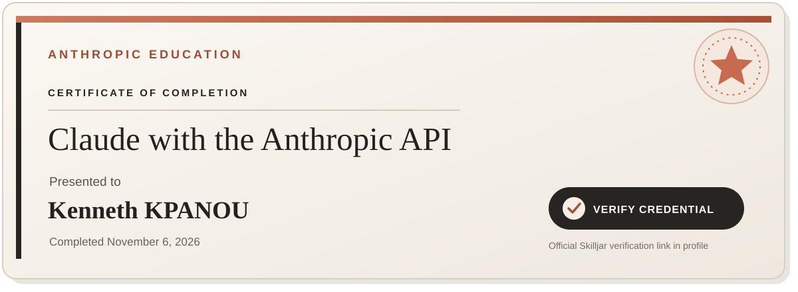
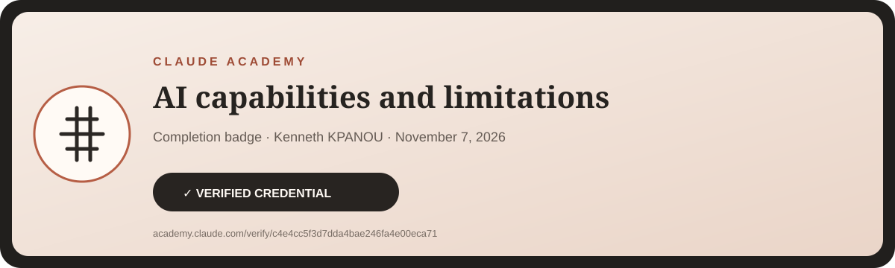
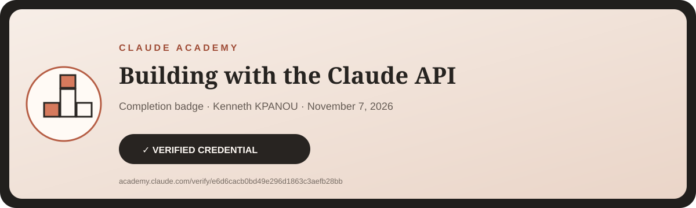

# KPANOU Kenneth

**Full-Stack Developer · UX/UI & Product Design · React · TypeScript · AI-assisted product development**

  

Engineering, product thinking and visual design — from idea to polished web experience.

---

## 👋 About me

I build **modern web products and digital experiences** with a strong focus on the intersection of:

- 🧠 **Product thinking** — turning an idea into a usable experience
- ⚙️ **Engineering** — maintainable, responsive and production-oriented code
- 🎨 **UX/UI & Product Design** — user research, personas, wireframes, prototyping, usability testing and responsive interfaces
- 🤖 **AI** — practical use of modern AI APIs, agents and AI-assisted workflows

My work spans **frontend engineering, full-stack product development, UI/UX design and digital experiences**.

> I care about the last 10%: the details that make a product feel finished.

---

## 🏅 Verified credentials

**4 verifiable learning credentials · 3 recognised technology providers**

  

### IBM SkillsBuild · User Experience Design Fundamentals

**Verified Digital Badge · November 8, 2026**

UX foundations: user research, personas, wireframes, prototyping, usability testing and UX collaboration.

  

### Anthropic Education · Certificate of Completion

**Claude with the Anthropic API**  
**Anthropic Education · Certificate of Completion · November 6, 2026**

### Claude Academy · Verified Course Completion Badges

| Credential | Issuer | Exact credential type | Date | Verification |
|---|---|---|---:|---|
| **User Experience Design Fundamentals** | IBM SkillsBuild | Digital Badge | Nov 8, 2026 | [Verify on Credly](https://www.credly.com/badges/d2fbad1e-6788-4c7f-a77d-d8f2726801da) |
| **Claude with the Anthropic API** | Anthropic Education | Certificate of Completion | Nov 6, 2026 | [Verify on Skilljar](https://verify.skilljar.com/c/jshitiofo33z) |
| **AI capabilities and limitations** | Claude Academy | Course Completion Badge | Nov 7, 2026 | [Verify](https://academy.claude.com/verify/c4e4cc5f3d7dda4bae246fa4e00eca71) |
| **Building with the Claude API** | Claude Academy | Course Completion Badge | Nov 7, 2026 | [Verify](https://academy.claude.com/verify/e6d6cacb0bd49e296d1863c3aefb28bb) |

> **Credential terminology:** IBM SkillsBuild issued a verifiable **Digital Badge**; Anthropic Education issued a **Certificate of Completion**; Claude Academy issued two **Course Completion Badges**.

---

## 🛠️ Core stack

### Frontend

### Backend & data

### Product & delivery

### AI & modern web workflows

**Claude API · AI-assisted development · MCP · API integration · agent-oriented workflows · prompt engineering**

---

## 🚀 Selected work

<table>
<tr>
<td width="50%" valign="top">

### UNYVON
**Business product / SaaS**

A digital business-management product focused on practical operations and decision-making.

**Stack:** Next.js / React / TypeScript

</td>
<td width="50%" valign="top">

### Iconlabs
**Digital studio**

A digital-agency experience covering design, web development, responsive interfaces and digital strategy.

**Stack:** HTML / CSS / JavaScript

</td>
</tr>

<tr>
<td width="50%" valign="top">

### Portfolio
**Personal product / interactive portfolio**

A retro-inspired interactive portfolio designed to present projects, skills and verified professional information.

**Focus:** UX / interaction / responsive design

</td>
<td width="50%" valign="top">

### SISTER-Birthday
**Interactive creative experience**

A cinematic birthday experience combining storytelling, photography, motion and interactive wishes.

**Stack:** React / TypeScript / Vite / Tailwind CSS

</td>
</tr>
</table>

**More work:** [browse all public repositories →](https://github.com/KennethKpn?tab=repositories)

---

## 🎯 What I build

- 🌐 Modern websites and landing pages
- 📊 Business dashboards and internal tools
- 🧩 SaaS / product interfaces
- ⚛️ React & Next.js applications
- 🎨 UI/UX systems and responsive experiences
- 🔌 API integrations and full-stack features
- 🤖 AI-powered interfaces and API integrations
- ✨ Interactive / cinematic web experiences

---

## 📈 GitHub activity

 

---

## 🧭 Current direction

**Building digital products where engineering, design and AI meet.**

Current interests include:

- AI-assisted software development
- Claude / API-based AI experiences
- Product-oriented frontend architecture
- High-quality responsive UI
- Design systems and interaction design
- Shipping practical products for real users

---

## 🤝 Let's connect

  

Open to thoughtful collaborations, product work and ambitious web experiences.

---

### ⚡ Build. Refine. Ship.

© Kenneth Kpn · Benin

